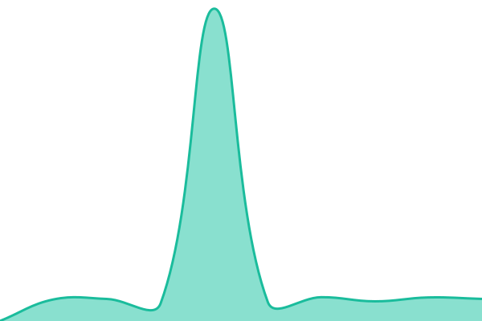
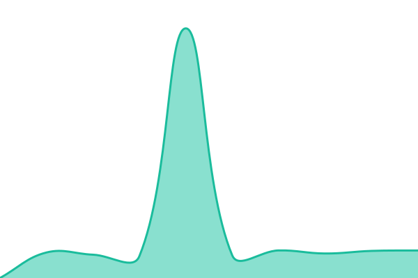

# [📈 Live Status](https://status.okcheese.com): <!--live status--> **🟩 All systems operational**

This repository contains the open-source uptime monitor and status page for [Zhifei Li](https://zhifei.li), powered by [Upptime](https://github.com/upptime/upptime).

With [Upptime](https://upptime.js.org), you can get your own unlimited and free uptime monitor and status page, powered entirely by a GitHub repository. We use [Issues](https://github.com/andylizf/status/issues) as incident reports, [Actions](https://github.com/andylizf/status/actions) as uptime monitors, and [Pages](https://status.okcheese.com) for the status page.

<!--start: status pages-->
<!-- This summary is generated by Upptime (https://github.com/upptime/upptime) -->
<!-- Do not edit this manually, your changes will be overwritten -->
<!-- prettier-ignore -->
| URL | Status | History | Response Time | Uptime |
| --- | ------ | ------- | ------------- | ------ |
|  [Website](https://okcheese.com) | 🟩 Up | [website.yml](https://github.com/SageSeekerSociety/status/commits/HEAD/history/website.yml) | 

 2655ms
     
 | 

<a href="https://status.okcheese.com/history/website">98.77%</a>
    

|  [API](https://okcheese.com/api/healthz) | 🟩 Up | [api.yml](https://github.com/SageSeekerSociety/status/commits/HEAD/history/api.yml) | 

 2340ms
     
 | 

<a href="https://status.okcheese.com/history/api">98.78%</a>
    

|  [WWW](https://www.okcheese.com) | 🟩 Up | [www.yml](https://github.com/SageSeekerSociety/status/commits/HEAD/history/www.yml) | 

 3172ms
     
 | 

<a href="https://status.okcheese.com/history/www">98.79%</a>
    

|  [Previews](https://preview-00000000000000000000000000000000.cheeseusercontent.com/) | 🟩 Up | [previews.yml](https://github.com/SageSeekerSociety/status/commits/HEAD/history/previews.yml) | 

 1209ms
     
 | 

<a href="https://status.okcheese.com/history/previews">98.80%</a>
    

<!--end: status pages-->

[**Visit our status website →**](https://status.okcheese.com)

## 📄 License

- Powered by: [Upptime](https://github.com/upptime/upptime)
- Code: [MIT](./LICENSE) © [Anand Chowdhary](https://anandchowdhary.com)
- Data in the `./history` directory: [Open Database License](https://opendatacommons.org/licenses/odbl/1-0/)
